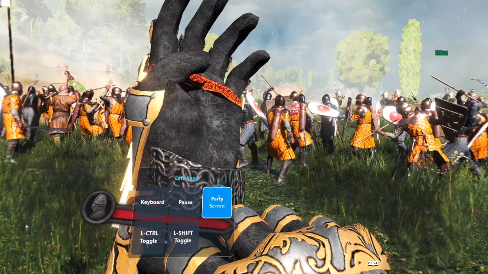
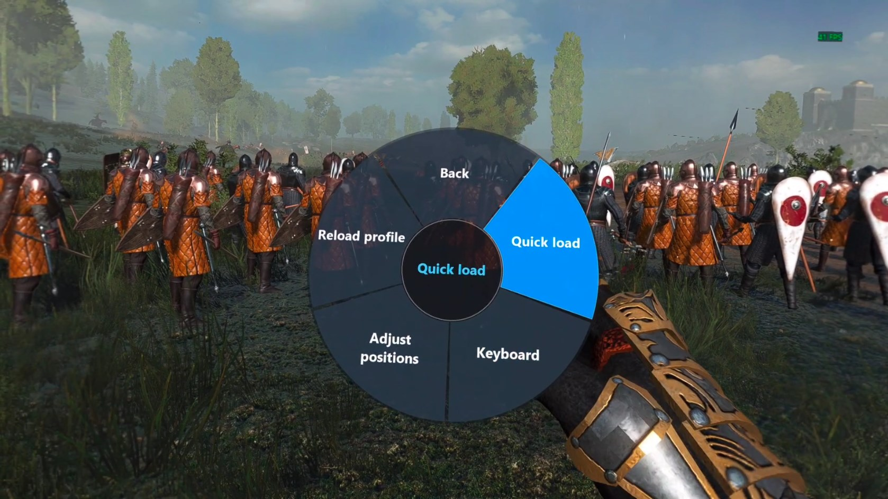
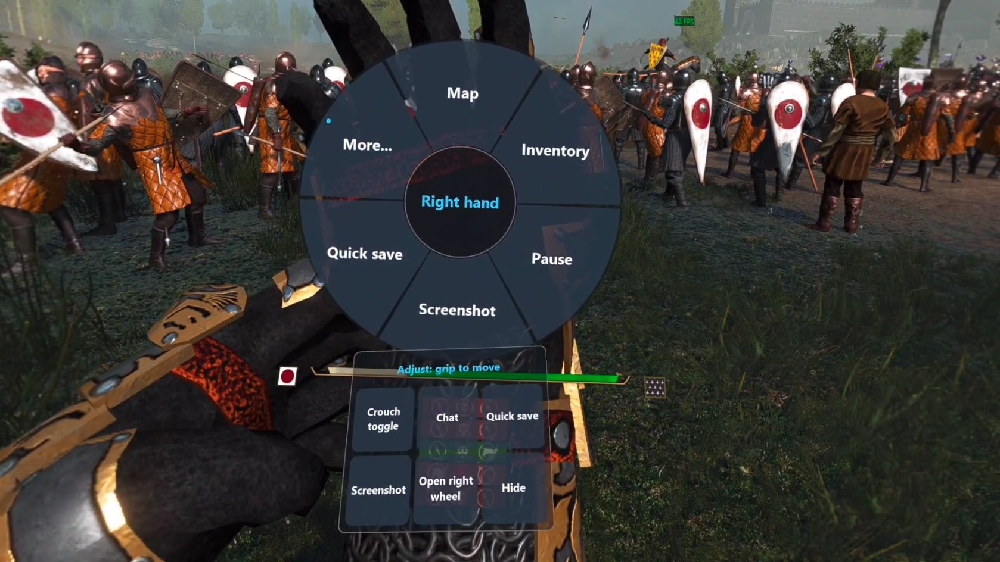
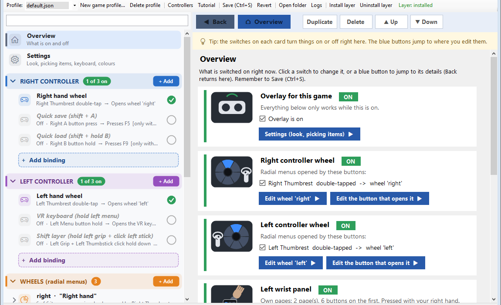
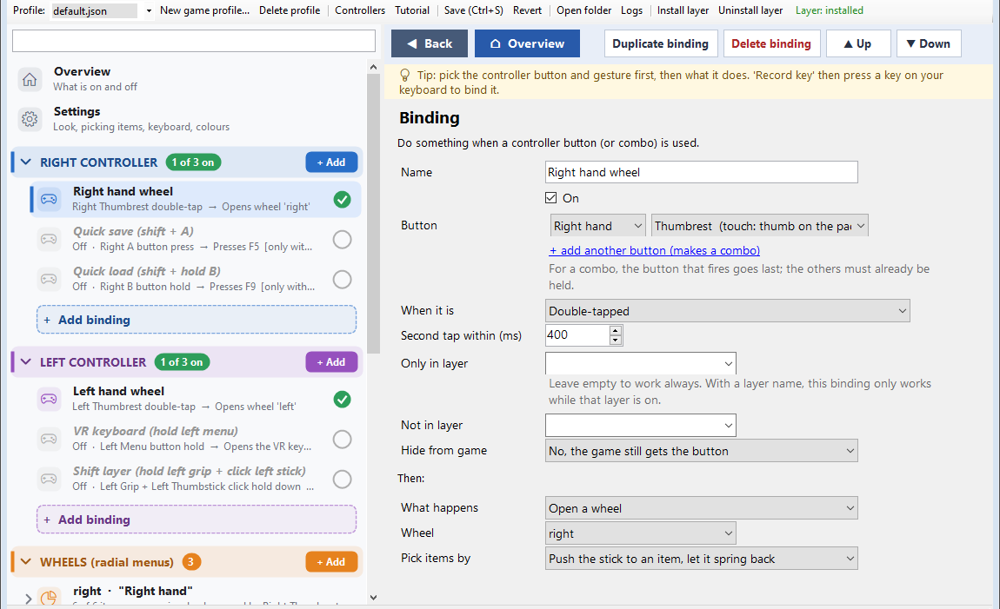
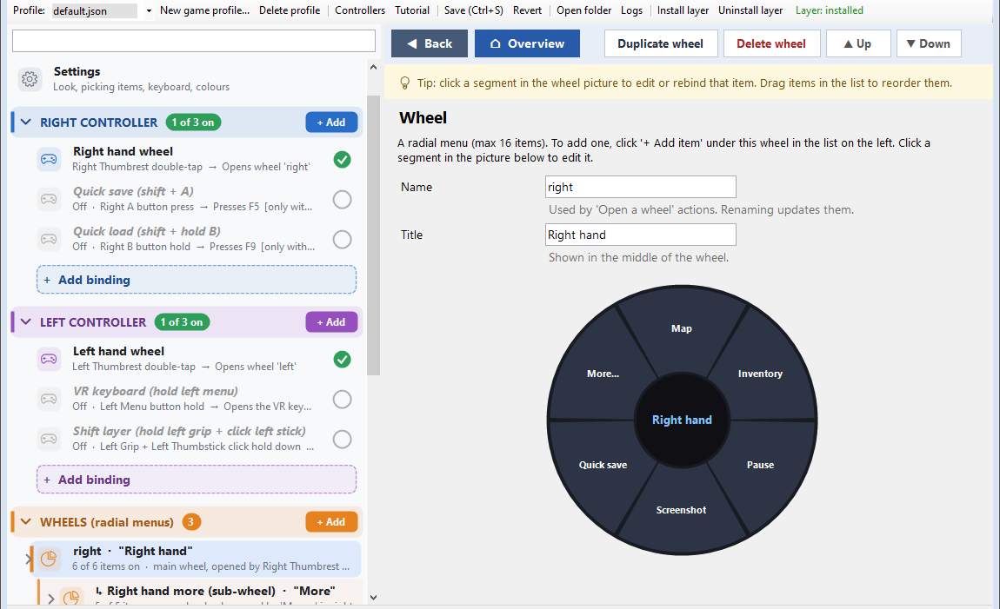
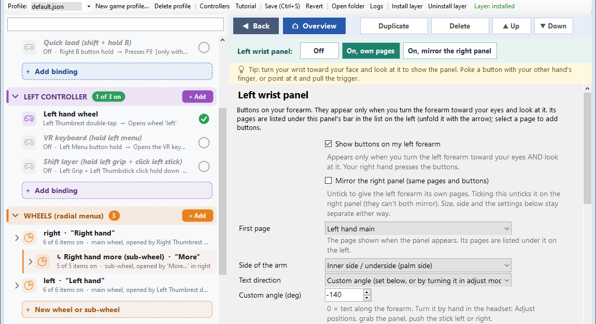

# OpenXR Hand Menus

Radial wheels, wrist panels, button combos and a VR keyboard for any OpenXR game. It's an OpenXR API layer, so it works under Virtual Desktop (VDXR), SteamVR OpenXR, Meta Link, Pimax and other runtimes without patching the game or the runtime, the same way OpenXR Toolkit loads. A desktop editor sets everything up, with per-game profiles.

**[Download the latest release](https://github.com/AtsukoK/OpenXR-Hand-Menus/releases/latest)** · **[My other work and support on Patreon](https://www.patreon.com/cw/AtsukoK)**

## Screenshots

**Wrist panel:** turn your wrist toward you and look at it. Poke a button with your other hand (a ring shows where you'll touch), or point at it and pull the trigger.

**Radial wheel:** opens in front of you. Pick an item with the stick or by pointing. Items can open sub-wheels.

**Adjust mode:** move and resize the wheel and wrist panels by hand in the headset: grab with the grip, and use the stick to resize or turn.

Screenshots from Mount & Blade II: Bannerlord in VR.

## Install

1. Download `OpenXRHandMenus-vX.Y.Z.zip` from the [latest release](https://github.com/AtsukoK/OpenXR-Hand-Menus/releases/latest) and **extract the whole zip** to a folder it can stay in. The game loads the layer from there.
2. Run `OpenXRHandMenusEditor.exe`. The first time, it asks which controllers you use, so it can pick the buttons that open the wheels, and offers a two-minute tour.
3. Click **Install layer** in the toolbar (needs admin, because OpenXR layers are registered under HKLM). The toolbar then shows "Layer: installed".
4. Start any OpenXR game. A message at the bottom of your view, "Hand menus: default.json loaded", means the layer is running.
5. Change things in the editor and save (Ctrl+S). A running game reloads the profile within a second.

## Using the editor

The editor opens on the **Overview**: one card per feature, with a switch to turn it on or off and a blue button that jumps to its settings. The list on the left holds everything in the profile, grouped by controller, wheels and wrist panels.

**Bindings** decide what a controller button does. Pick the hand and button, how it's used (press, hold, double tap...), and what happens. You can open a wheel, press a key (**Record key** captures it from your keyboard), run a macro, open the VR keyboard, and more. "+ add another button" makes a combo.

**Wheels** show a live picture. Click a segment to edit that item, use "+ Add item" or "+ Add sub-wheel" under a wheel in the list, and drag items to reorder them.

**Wrist panels** can be off, have their own pages, or mirror the other arm. Set the side of the arm, the text direction and the size here, or move them by hand in the headset with **Adjust positions**.

## Files and switching it off

Turn it off for one game with `enabled: false` in that game's profile. Remove it entirely with **Uninstall layer**. Setting the environment variable `DISABLE_XR_APILAYER_NOVENDOR_openxr_hand_menus=1` also disables it.

Files live in `%LOCALAPPDATA%\OpenXRHandMenus\`:
- `profiles\default.json` is used by every game that has no profile of its own.
- `profiles\<exe name>.json` is a per-game profile (for example `profiles\bannerlord.json`).
- `profiles\icons\*.png` holds optional item icons.
- `logs\<exe name>.log` is one log per game, and is the first place to look when something doesn't work.

## Concepts

**Inputs** are written `hand.part[.feature]`:

| part | notes |
|---|---|
| `a` `b` (right) / `x` `y` (left) | also `primary` / `secondary`; add `.touch` for capacitive touch |
| `trigger`, `grip` | analog, pressed past `thresholds.press_on`; `trigger.touch` |
| `thumbstick` | click; `.touch`, `.up` `.down` `.left` `.right` for directions |
| `thumbrest` | touch only (Quest/Touch controllers) |
| `menu` | left menu button (Touch); both hands on WMR/Vive |

**Chords**: `left.grip+right.b` means hold left grip, then press B. The last input is the trigger and the others must already be held. When several bindings match the same press, the most specific one wins (more chord inputs or more layer conditions). This lets `right.b` stay the game's B while `left.grip+right.b` does something else.

**Gestures**: `press`, `tap` (quick release; can share a button with a `hold`), `hold` (after `hold_ms`), `double_tap`, `while_held` (start on press, stop on release).

**Layers** change what normal buttons do. A binding with `"action": {"type": "layer", "layer": "shift", "mode": "hold"}` turns `shift` on while held, or use `toggle`, `on` or `off`. Any binding with `"layers": "shift"` only works while that layer is on, and its button is hidden from the game. That gives you a whole second set of controls.

**Blocking**: `block` on a binding hides its trigger (`trigger`) or all its chord buttons (`all`) from the game while held. `tap_passthrough` on a hold binding sends the game a short press if you let go early, so one button can do "tap = game, hold = mine". While a wheel is open, `block_while_open` hides input from the game: `none`, `minimal`, `hand` or `all`. A blocked button stays hidden until you let go of it, so the game never sees a half press.

**Actions**

| type | fields | |
|---|---|---|
| `key` | `keys` ("Ctrl+S", "F5", "LMB", "WheelUp", "Num5"), `mode` tap/hold/toggle, `tap_ms` | SendInput with scan codes |
| `sequence` | `steps`: `Ctrl+C; wait 100; down W; wait 1500; up W` | macro |
| `xr_input` | `target` input, `mode` tap/hold/toggle | makes the game think a controller button is pressed (remap) |
| `wheel` | `wheel` name, `confirm` auto/release/stick_return/button | opens a wheel, or a submenu inside one |
| `back`, `close` | | wheel navigation |
| `layer` | `layer`, `mode` hold/toggle/on/off | |
| `reload` | | reload the profile |

**Wheel confirm modes**
- `stick_return`: push the stick toward an item and let it spring back. This is the default for thumbrest or touch openers, because your thumb leaves the thumbrest to use the stick.
- `release`: hold the opener, point the stick, let go. Resting on a submenu item for `submenu_dwell_ms` opens it.
- `button`: the confirm button (`selection.confirm_button`) picks the item.
- In every mode the confirm button also works, and the cancel button (`selection.cancel_button`, default B/Y) goes back or closes.

**Placement** (`style.anchor`): `head_locked` (default; appears in front of you, 0.70 m away, and stays put), `head` (follows your view), `hand_locked` (appears above the opening hand and stays put), or `hand` (follows the hand). The wheel always turns to face you. `selection.method` is `both` by default (stick or pointer); `thumbstick` or `point` allow only one.

## Limits
- OpenXR games only. Games that use the SteamVR (OpenVR) API or the Oculus LibOVR API never load OpenXR layers.
- The wheel is drawn for D3D11 and D3D12 games. Vulkan or OpenGL games still get the bindings, chords and layers, but no visible wheel.
- Keys go to the foreground window. If a game ignores them, try `focus_game_window: true`.
- Multiplayer games with anti-cheat may object to any injected layer.

## Building

Needs Visual Studio Build Tools (C++ with CMake) and the .NET 10 SDK.

- Layer: `cmake -S layer -B layer/build -A x64` then `cmake --build layer/build --config Release`
- Editor: `dotnet publish editor/OpenXRHandMenusEditor.csproj -c Release -o editor/bin/publish`
- `build_all.ps1` does both and fills `dist\` (it uses the author's local tool paths in `layer\build.bat`).

`layeruildro_test.exe` runs the offline engine tests. The GitHub Actions workflow builds the same tester package on every push.

## Support

If OpenXR Hand Menus is useful to you, you can support its development and find my other VR mods on **[Patreon](https://www.patreon.com/cw/AtsukoK)**. Bug reports and ideas are welcome as [GitHub issues](https://github.com/AtsukoK/OpenXR-Hand-Menus/issues).

## Licence

GPLv3, see [LICENSE](LICENSE). Changes per version: [CHANGELOG.md](CHANGELOG.md). Third-party code: [nlohmann/json](third_party/nlohmann) (MIT) and the [OpenXR SDK](third_party/openxr-sdk) (Apache-2.0); their licences are kept in their folders. Code signing: see [CODE_SIGNING_POLICY.md](CODE_SIGNING_POLICY.md).
